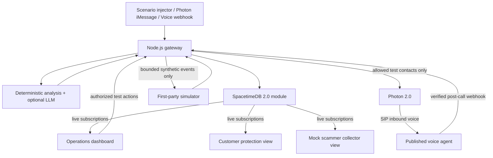

# Architecture and contracts

> This is a **proposed implementation**, not documentation of running code. `AGENTS.md` governs scope and safety.

## Component map

**SpacetimeDB is the authority** for incidents, campaigns, decoy sessions, event history, and customer interventions. The gateway does not maintain a competing state store. UI views subscribe to live data, not to fake counters maintained in React component state.

## Responsibilities

### SpacetimeDB module (`spacetimedb/src/index.ts`)

- Define tables and indexes for incident lookup, campaign correlation, and session event lookup.
- Enforce valid state transitions: `reported -> analyzed -> linked -> protected/resolved`; `prepared -> engaging -> completed/aborted` for decoys.
- Use reducers for all persistent mutations and enforce idempotency. Track `sourceKind`: `seed`, `manual_demo`, `photon_message`, `photon_voice`, `voice_simulation`.
- Update campaign counts and decoy metrics from authoritative rows rather than trusting arbitrary browser-supplied totals.
- Expose **sanitized synthetic demo rows** to live UI subscriptions. Place any genuinely sensitive provider payloads in private server-only storage or avoid storing them.
- Do not perform third-party HTTP calls in ordinary reducers; gateway handles external I/O.

### Gateway (`services/gateway/src/`)

- Accept synthetic scenarios from an authenticated operator/test-only route.
- Verify provider webhooks and deduplicate event IDs. Use polling only when official provider docs say it is supported.
- Perform safe text-based scam analysis (no browsing unknown URLs), optional LLM enrichment, and deterministic campaign correlation.
- Normalize Photon message/call events into domain events and call SpacetimeDB reducers.
- Restrict message sends and tests to an explicit contact allowlist; require `ENABLE_LIVE_MESSAGING=true` for actual sends.
- Run a bounded decoy event simulator *only* against owned endpoints. Include `MAX_DECOY_EVENTS_PER_RUN` and per-run idempotency keys.

### Frontend (`src/`)

- 3 routes or tabbed views: `/ops`, `/customer`, `/collector`.
- `Ops`: map/graph of campaign-to-incident relationships, event timeline, relevant metrics, call/message status, run-demo buttons.
- `Customer`: concise explanation, confidence label, recommended next steps, status, privacy statement.
- `Collector`: explicitly `SIMULATED SCAMMER VIEW`, synthetic lead rows, decoy ratio, provenance of each record.
- Support a known-good synthetic demo with no external credentials.
- Avoid splash animations that obscure readability or prevent the presentation from completing within 3 minutes.

## Minimal data model

Use `AGENTS.md` for the required table names. Additional suggested fields:

- `incidents`: `externalEventId?`, `evidenceJson` or separate evidence table, `riskCategory`, `sourceKind`, `scenarioId`.
- `campaigns`: `patternKeys` / tags for correlation, optional `lastAlertAt`.
- `decoy_sessions`: persona key and scenario key, never real credentials or contact details.
- `decoy_events`: `collectorRecordId`, `eventType`, `sourceKind='simulated'`, `timestamp`.
- `provider_events` (private or minimal safe dedupe table): `(provider, externalEventId)` unique, processedAt, status. Do not expose raw webhook payloads publicly.

For a 12-hour prototype, a sanitized summary in `incidents` is enough: no requirement to store full transcripts, raw emails, or real phone numbers.

## Correlation v1 (explainable, deterministic)

Use a normalized subset of signals: impersonated brand, URL hostname (only syntactically parsed, not visited), request type (payment, credentials, OTP, remote access), message tactic (urgency, authority, prize, delivery), and optionally a synthetic test sender ID. Match campaigns using a transparent weighted score and list the matching signals. Do **not** silently combine separate people or unrelated incidents on weak evidence. If uncertain, present a suggested link for operator confirmation.

For a demo, seed two wording variants with the same fake hostname (`parcel-check.example.com`) and impersonation pattern, making the campaign match observable without relying on probabilistic model behavior.

## Risk and confidence presentation

Risk and confidence are different. Show `riskLevel: low | medium | high` and `confidenceLabel: low | medium | high`, evidence, and action. Never present an invented percentage such as `99.8% certain` unless calibrated with actual tests. Provide safe action text like "Verify in the courier's official app" rather than encouraging link-clicking or callback to a suspicious number.

## MVP security model

- Local/trusted team demo by default, using only synthetic data in visible/public tables.
- Protected operator-only routes via a local demo secret / session or equivalent minimal approach; do not include secrets in frontend code.
- Restrict CORS origins and validate request bodies.
- Provider webhooks are signed/verified according to current provider docs. Reject invalid signatures and dedupe retries.
- Real-world multi-tenant auth, production fraud response, and actual carrier interception are **out of scope**.

## State propagation tests

1. Submit `reportIncident` via gateway; verify a subscribed Ops view updates without reload.
2. Create `decoy_session`, advance state, append events; verify *both* Ops and Collector update live.
3. Submit the same external provider event twice; verify one logical incident/event.
4. Attempt unauthorized operator mutation; verify rejection.
5. Disconnect and reconnect one browser; verify subscription state recovers without duplicated events.
